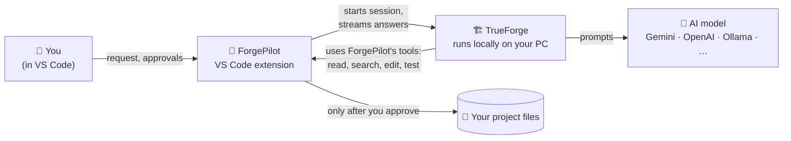

<div align="center">

# 🔨 ForgePilot

**An AI coding assistant inside VS Code that shows you every change before it happens.**

Describe what you want in plain English. ForgePilot finds the right files, writes the change,<br>and lets you approve it piece by piece. Nothing touches your files without your OK.


[What it does](#-what-it-does) · [How it works](#-how-it-works-in-plain-words) · [Install](#-install-in-6-steps) · [Use it](#-how-to-use-it) · [Troubleshooting](#-troubleshooting) · [For developers](#-for-developers)

**Demo video:** _coming soon_

</div>

---

## ✨ What it does

| | Feature | In plain words |
|---|---|---|
| ✏️ | **Inline edit** | Highlight some code, press `Ctrl+Alt+K`, type *"make this handle empty input"*. The suggested change appears as a before/after view, and you accept or reject each part. |
| 🤖 | **Agent mode** | Type a bigger request in the side panel, such as *"add a new command, test it and document it"*. The agent searches the project, finds the files that need changing, and edits all of them. |
| 🔎 | **Smart context** | Real projects are too big for an AI to read at once. ForgePilot picks the most relevant pieces within a fixed size limit and **shows you which files it chose and why**. |
| 🛡️ | **Review before save** | Every change is held back until you approve it, one block at a time. Approved changes can be undone with one click. |
| ⏹️ | **Stop anytime** | Watch the answer appear word by word. Press Stop at any moment and your files stay exactly as they were. |
| 🔁 | **Never stuck on one AI** | If the main AI service fails (bad key, outage, rate limit), ForgePilot waits and retries, or switches to the next AI you've set up. |

---

## 🧠 How it works (in plain words)

Think of a building contractor:

- **You** are the homeowner. You describe what you want and approve the plans.
- **ForgePilot** (in VS Code) is your site manager. It can read the blueprints (your code), propose changes, and only builds what you sign off on.
- **TrueForge** is the contractor's office. It runs the conversation with the AI, remembers what happened, and asks for your approval at the right moment.
- **The AI model** (Gemini, GPT, Claude, or a free local one) is the architect who comes up with the ideas.



**What happens when you ask for a change:**

1. You type a request.
2. TrueForge asks the AI what to do. The AI uses ForgePilot's tools to look around your project: *find relevant code → read files → search*.
3. The AI drafts edits. ForgePilot holds them **in memory**, not in your files.
4. When the AI is done, TrueForge **pauses** and ForgePilot shows you every change as a before/after view.
5. You click ✓ or ✗ on each block. Only the ✓ blocks are saved, as one change you can undo.
6. The AI can then run the project's tests and fix anything that broke, again with your approval.

> 💡 **ForgePilot never talks to an AI company directly.** All AI traffic goes through TrueForge, and your API keys live only in TrueForge on your own computer. You can switch between Gemini, OpenAI, Claude or a free local model without changing ForgePilot.

---

## 🚀 Install in 6 steps

### What you need first

| Tool | Why | Get it |
|---|---|---|
| **Node.js 22.14+** | Runs TrueForge and builds the extension | [nodejs.org](https://nodejs.org) (LTS) |
| **VS Code 1.90+** | Where ForgePilot lives | [code.visualstudio.com](https://code.visualstudio.com) |
| **Git** | Downloads this project | [git-scm.com](https://git-scm.com) |
| **An AI model** | The brain. A free option is fine | See [step 4](#step-4--connect-an-ai-model) |

Check your versions in a terminal: `node -v` should print `v22.14` or higher.

### Step 1 · Download ForgePilot

```bash
git clone https://github.com/kevinmathew47/forgepilot.git
```
```bash
cd forgepilot
```

### Step 2 · Build it

```bash
npm install
```
```bash
npm run build
```

### Step 3 · Start TrueForge (the "office")

Keep this terminal open while you use ForgePilot.

**Windows (PowerShell):**
```powershell
powershell -ExecutionPolicy Bypass -File .\scripts\start-trueforge.ps1
```
**macOS / Linux:**
```bash
bash scripts/start-trueforge.sh
```

✅ **Success:** open http://localhost:8790 in your browser and you see the TrueForge dashboard.

<details>
<summary>What does this script do?</summary>

It runs `npx @truefoundry/trueforge@latest` in local mode. Its data is stored in `.trueforge/` inside this folder, and nothing is deployed online. It also allows connections to `localhost`, which TrueForge blocks by default: ForgePilot's tools and local AI models both run on your own machine.
</details>

### Step 4 · Connect an AI model

Pick **one** of these options. You can add more later as backups.

<details open>
<summary><b>Option A: free Google Gemini (recommended for beginners)</b></summary>

1. Go to [aistudio.google.com](https://aistudio.google.com) → **Get API key** → create a key.
2. In the `forgepilot` folder, copy the example files:
   - Windows: `copy .env.example .env` and `copy config\models.example.json config\models.json`
   - macOS/Linux: `cp .env.example .env` and `cp config/models.example.json config/models.json`
3. Open `.env` and fill in the line `GEMINI_API_KEY=your-key-here`.
4. Register the models with TrueForge:
   ```bash
   node scripts/configure-models.mjs
   ```
   It prints the models now available, such as `google-gemini/gemini-3-5-flash-lite`.

> 🔒 `.env` and `config/models.json` are git-ignored, so your key is never uploaded.
</details>

<details>
<summary><b>Option B: use the TrueForge website instead</b></summary>

Open http://localhost:8790 → **Settings → Models** → choose a provider (OpenAI, Anthropic, Gemini, …) → paste your key → **Create**.
</details>

<details>
<summary><b>Option C: a free local model with Ollama (no key, works offline)</b></summary>

1. Install [Ollama](https://ollama.com) and run `ollama pull qwen2.5:7b`.
2. Keep the `ollama` entry in `config/models.json` and run `node scripts/configure-models.mjs`.

Local models are free and private, but slower and weaker on big multi-file tasks. They work well as a **backup** model.
</details>

### Step 5 · Launch ForgePilot in VS Code

1. Open the `forgepilot` folder in VS Code.
2. Press **F5**. A second VS Code window opens, titled *Extension Development Host*.
3. In that new window, **File → Open Folder…** and open the project you want to work on.

✅ **Success:** the bottom-right status bar shows something like `🔌 TrueForge · gemini-3-5-flash-lite → qwen2-5-7b`, and a 🔨 ForgePilot icon appears in the left sidebar.

### Step 6 · Pick your models (optional)

Press `Ctrl+Shift+P` → **ForgePilot: Select Models** → choose the **main** model, then any **backup** models in order. If you skip this, ForgePilot uses every model in TrueForge, in TrueForge's order.

---

## 🎯 How to use it

### ✏️ Inline edit: change a piece of code

1. **Select** a function or a few lines.
2. Press **`Ctrl+Alt+K`** (macOS: `Cmd+Alt+K`), or right-click → **ForgePilot: Inline Edit Selection**.
3. Type what you want, for example *"also treat 'off' as false and update the docstring"*.
4. A **before ↔ after** tab opens and fills in as the AI writes.
5. Above each changed block, click **✓ Accept** or **✗ Reject**. When every block is decided, the accepted ones are saved.

### 🤖 Agent mode: bigger, multi-file changes

1. Click the **🔨 ForgePilot** icon in the left sidebar.
2. Type a request, for example *"Add a `flask config` command that prints the config as JSON with secrets hidden. Add a test and document it."*
3. Watch it work:
   - a **Context** card lists the files it chose, why, and how much of its reading budget it used;
   - tool steps (*read_file, edit_file …*) stream in live;
   - a grey **"staged, not on disk"** bar shows edits waiting for your review.
4. When it asks for approval, before/after tabs open for each file and a review card appears in the panel. Accept or reject each block, or use **Accept all** / **Reject all**.
5. The agent may run the tests and propose a fix. Review that the same way.

**Tips:**
- Type **`@`** to point at a specific file or function (for example `@src/app.py` or `@get_debug_flag`). It's optional, because the agent finds files on its own.
- **Session ↗** opens the full run in TrueForge's website, with every step and tool call.
- **New** starts a fresh conversation.

### ⏹️ Stop, ↩️ undo, 🔁 switch models

| I want to… | Do this |
|---|---|
| Stop the AI right now | Click **■ Stop** in the panel, press `Ctrl+Alt+X`, or click the spinning item in the status bar |
| Undo the last approved change | Click **Undo last** in the panel (or `Ctrl+Z` in the file) |
| Use a different AI | **Models** button in the panel, or **ForgePilot: Select Models** |
| Accept / reject the block at my cursor | `Ctrl+Alt+Y` / `Ctrl+Alt+N` |

### 🛡️ Safety promises

- ✅ **Nothing is written** to your files until you accept it.
- ✅ **Stop leaves no half-done edits.** Unapproved changes are thrown away.
- ✅ **Every approved change can be undone** in one step.
- ✅ The agent may only run safe commands (tests, `python`, `git status` …) on its own. Anything else asks you first.
- ✅ Your API keys stay in TrueForge on your machine. ForgePilot never sees or sends them.

---

## 🩺 Troubleshooting

| You see | Fix |
|---|---|
| Status bar says **TrueForge offline** | Start TrueForge (step 3), then `Ctrl+Shift+P` → **ForgePilot: Reconnect** |
| `Failed to connect to remote MCP server 'forgepilot-editor' … ECONNREFUSED` | The ForgePilot window that registered its tools was closed. Click into your current ForgePilot window or run **ForgePilot: Reconnect**; it re-registers automatically on every request. |
| **no model configured in TrueForge** | Do step 4, then **ForgePilot: Reconnect** |
| `429 … quota` / "retrying in 37s" | Free AI tiers limit requests per minute. ForgePilot waits and continues on its own; add a backup model to keep going faster |
| `401 Incorrect API key` | The key is wrong or expired. ForgePilot switches to your backup model; fix the key in `.env` and rerun `node scripts/configure-models.mjs` |
| The agent only summarises and doesn't edit | Small local models sometimes stop early. ForgePilot nudges them automatically, but a stronger main model (for example Gemini) works much better |
| `node` says the version is too old | Install Node.js 22.14 or newer |

---

## 🛠️ For developers

<details>
<summary><b>Architecture</b></summary>

```
VS Code extension (TypeScript)
 ├─ TrueForge client (@truefoundry/trueforge-sdk): sessions, turn streams, approvals, cancel
 ├─ Editor MCP server (streamable HTTP on 127.0.0.1:8791/mcp), registered in TrueForge as "forgepilot-editor"
 │    find_relevant_code · repo_map · list_files · read_file · search_code · find_symbol
 │    edit_file · write_file · show_staged_changes · discard_staged · submit_changes · run_command
 ├─ Changeset: staged edits held in memory, never on disk until reviewed
 ├─ Review controller: virtual-document diff editors, per-hunk CodeLens, panel review card
 ├─ Context engine: symbol index, BM25, import graph, token budget
 └─ Webview panel: streamed transcript, context card, subagent threads, review, undo
```

- The extension **never calls a model provider**. Every model call goes through TrueForge, and the agent (not the extension) decides what to read and change, through the MCP tools.
- `submit_changes` is in `require_approval_for_tools`. TrueForge's `tool.approval_required` pause opens the hunk review; accepting sends `user.tool_approval: allow` and the MCP call writes the accepted hunks as one `WorkspaceEdit`.
- Harness features used: tool approval, dynamic subagents, deferred tool loading (eight core tools preloaded, the rest deferred), and context compaction.
</details>

<details>
<summary><b>How context is chosen</b></summary>

1. **Explicit:** `@file` and `@Symbol` mentions, with autocomplete, are attached verbatim (12k-token cap).
2. **Automatic** (`find_relevant_code`, default budget 6,000 tokens):
   - index from `git ls-files`; Python chunked per `def`/`class`, docs per section;
   - BM25 ranking with identifier-aware tokens and a small synonym map;
   - exact identifiers named in the task pull in their defining file first;
   - import-graph neighbours are boosted, and *test* and *docs* intents add test counterparts and documentation pages;
   - greedy packing into the budget, with the files left out listed.
3. **Inline edit:** imports, lines around the selection, and definitions of identifiers it uses (3,000-token budget).

The same selection is shown in the panel's Context card, with file, role, score, tokens and why.
</details>

<details>
<summary><b>Agent definitions and how they are loaded</b></summary>

Agent definitions are in [`agent/`](agent):

- `forgepilot-coder.json`: agent mode. Uses the editor MCP server, with approval on `submit_changes`; subagents and compaction are on.
- `forgepilot-inline.json`: inline edit. No tools; returns one fenced replacement block.

Nothing needs importing by hand. On connect, the extension:

1. registers its MCP server in TrueForge as `forgepilot-editor`;
2. saves both definitions as named TrueForge agents, which you can see under **Agents** in the TrueForge UI;
3. creates a session per request from the definition, with the active model filled in. This is how fallback switches models without editing the saved agent.
</details>

<details>
<summary><b>Model fallback policy</b></summary>

| Error | What ForgePilot does |
|---|---|
| Per-minute rate limit (429 with "retry in N s") | Waits as long as the provider asks, up to 12 times, and **resumes the same session** with staged edits kept |
| Network or 5xx errors | Retries with exponential backoff (`forgepilot.retryAttempts`) |
| Invalid key, unknown model, per-day quota | Switches to the next model immediately |
| Every model fails | Clear error message; the workspace is untouched |
</details>

<details>
<summary><b>Settings and keybindings</b></summary>

| Setting | Default | Meaning |
|---|---|---|
| `forgepilot.trueforgeUrl` | `http://localhost:8790` | TrueForge server |
| `forgepilot.models` | `[]` | Ordered model names: primary first, then fallbacks |
| `forgepilot.mcpPort` | `8791` | Port for the editor MCP server |
| `forgepilot.contextBudgetTokens` | `6000` | Budget for automatically retrieved context |
| `forgepilot.retryAttempts` | `2` | Retries per model on transient errors |
| `forgepilot.allowedCommands` | `pytest`, `python`, … | Commands the agent may run without asking |

| Key | Action |
|---|---|
| `Ctrl+Alt+K` | Inline edit the selection (or the enclosing function) |
| `Ctrl+Alt+Y` / `Ctrl+Alt+N` | Accept / reject the hunk at the cursor |
| `Ctrl+Alt+Enter` | Apply review decisions |
| `Ctrl+Alt+X` | Cancel the running generation |
</details>

<details>
<summary><b>Automated tests and results</b></summary>

`test/` drives the real extension in a separate VS Code profile, against a live TrueForge:

```bash
FP_SCENARIO=taskA FP_MODELS=google-gemini/gemini-3-5-flash-lite node test/run.js
FP_SCENARIO=taskB FP_MODELS=google-gemini/gemini-3-5-flash-lite,google-gemini/gemini-3-5-flash node test/run.js
FP_SCENARIO=taskC FP_MODELS=openai/gpt-4-1-mini,google-gemini/gemini-3-5-flash-lite node test/run.js
FP_SCENARIO=cancel node test/run.js
```

On Windows, if the path contains spaces, run it from a junction without spaces and set `FP_EXT` and `FP_WORKSPACE`.

Results on [pallets/flask](https://github.com/pallets/flask) 3.1.3 (22d92470), a ~17k-line codebase:

| Scenario | Result |
|---|---|
| Inline edit: extend `get_debug_flag` | Diff streamed in ~5 s; 2 hunks accepted one by one; `FLASK_DEBUG=off`, `OFF`, `n`, `no`, `false` and `0` all give `False`; undo restored a clean `git status` |
| Agent mode: add a `flask config` command, with test and docs, without naming files | The agent found and edited `src/flask/cli.py`, `tests/test_cli.py` and `docs/cli.rst` unprompted, over 4 review rounds; `pytest tests/test_cli.py` gives 59 passed; `flask --help` lists `config`; secrets print as `"***"` ([diff](docs/agent-mode-result.diff)) |
| Resilience: invalid API key, then fallback | 401 from the invalid key, automatic switch to the next model, correct edit, `git status` clean throughout |
| Resilience: invalid API key only | Clear error in ~1 s, editor responsive, `git status` clean |
| Cancel mid-stream | Stopped in ~130 ms, review closed, `git status` clean |

`examples/demoapp/app.py` is a small Flask app with secret-looking config keys, used to show `flask config` masking.
</details>

---

## 📌 Project facts

- **Written from scratch.** Not a fork of Cline, Continue, Roo Code or opencode.
- **Agent loop:** TrueForge in local mode (`npx @truefoundry/trueforge@latest`), with editor capabilities exposed as MCP tools.
- **Models it was tested with:** Gemini 3.5 Flash-Lite and 3.5 Flash (Google AI Studio free tier) and Qwen2.5 7B via local Ollama. Any model you configure in TrueForge works.

## 🙏 Credits

Built with [TrueForge](https://github.com/truefoundry/trueforge) (MIT), run unmodified in local mode, and these packages under their licences: [`@truefoundry/trueforge-sdk`](https://www.npmjs.com/package/@truefoundry/trueforge-sdk) (MIT), [`@modelcontextprotocol/sdk`](https://www.npmjs.com/package/@modelcontextprotocol/sdk) (MIT), [`diff`](https://www.npmjs.com/package/diff) (BSD-3-Clause), [`zod`](https://www.npmjs.com/package/zod) (MIT).

## 📄 Licence

MIT. See [LICENSE](LICENSE).
